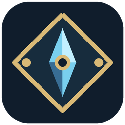
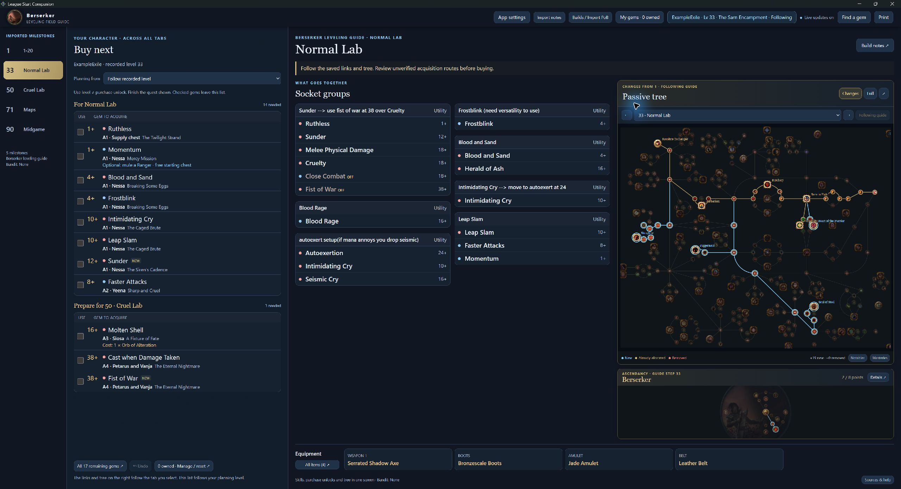

# League Start Companion

**Your Path of Building build, turned into a guide you can follow while you play.**

League Start Companion is a Windows app for **Path of Exile 1**. Import your PoB,
then keep your gem shopping list, skill links, passive tree, ascendancy and equipment
together in one view. Spend less time switching tabs and more time playing.

*An example imported leveling guide. Your milestones and setups come from your PoB.*

## What does it do?

- **Know which gems to get next.** See class-aware quest rewards and vendors,
  gem level requirements, and verified Siosa prices. Check off gems as you acquire
  them; the shopping list moves on to what you still need.
- **Follow your build's milestones.** See the skill and support gems that belong
  together, plus the equipment for each step.
- **See where to spend your passive points.** Compare checkpoints with new,
  retained and removed nodes highlighted. Zoom, pan, or preview the next tree
  independently of your gem setup. Ascendancy has its own diagram.
- **Keep your progress.** Gem purchases are saved per character, with undo and
  reset controls. Save, rename and remove imported guides in your build library.
- **Follow your character as you level.** Read level-ups and area changes from
  the local game log to advance through the guide automatically. You can also
  browse milestones yourself.

## Install on Windows

### [Download the latest Windows installer](https://github.com/iwouldrather/league-start-companion/releases/latest/download/LeagueStartCompanion-Setup.exe)

1. Download and run **LeagueStartCompanion-Setup.exe**.
2. Choose an install folder and whether you want **Desktop** and **Start menu** shortcuts.
3. Select **Install companion**, then **Launch companion**.

Requires **Windows 10 or 11, 64-bit**, and the
[Microsoft Edge WebView2 Runtime](https://developer.microsoft.com/en-us/microsoft-edge/webview2/).
You don't need Python or Codex. Tree assets for the bundled tree version are
included; other versions may require matching Path of Building Community data.
The installer is currently unsigned.

Prefer to check the release notes first? [Browse releases](https://github.com/iwouldrather/league-start-companion/releases).

## Create your first guide

1. Open **Builds / Import PoB** and paste a **pobb.in link**, **PoB export code** or **PoB XML**.
2. Review the milestones, levels and matching skill, tree and equipment sets,
   then choose **Generate & open guide**.
3. Open **App settings** and select your game's **Client.txt** if it wasn't found automatically.
4. Play alongside the guide and check off gems as you collect them.

PoBs with multiple leveling setups make the most useful leveling guides. An
endgame-only PoB gives you a reference setup; the app doesn't invent missing
leveling steps. Estimated milestone levels can be reviewed before importing.

## Updates and your saves

Updates download automatically in the background. When one is ready, choose
**Restart to update**. You can also check manually in **App settings**.

Builds and gem progress stay on your computer and are retained through updates
and uninstall. **App settings → Open save folder** takes you to them.

The app reads the game log without changing it or controlling the game. It can
follow recorded levels and areas; gem ownership, allocated passives, equipment
and quest completion still need your input.

## Feedback

Found a problem or have an idea? [Open an issue](https://github.com/iwouldrather/league-start-companion/issues).

Want to work on the app? See the [development guide](docs/DEVELOPMENT.md).

---

Built with data and assets from [Path of Building Community](https://github.com/PathOfBuildingCommunity/PathOfBuilding).
Path of Exile belongs to Grinding Gear Games. This project is not affiliated with
or endorsed by Grinding Gear Games. See [data sources and acknowledgements](THIRD_PARTY.md).
